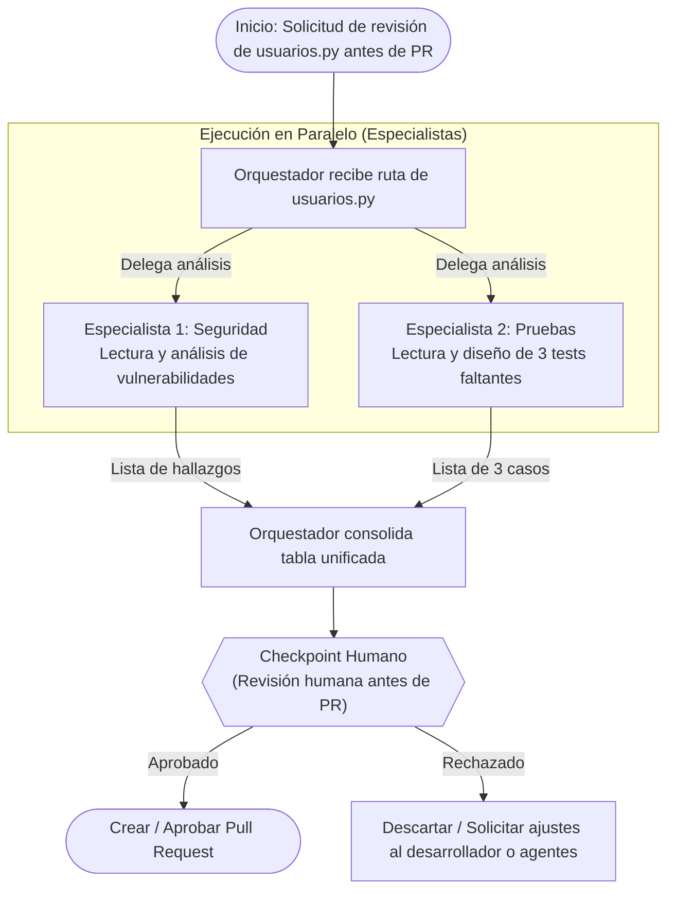
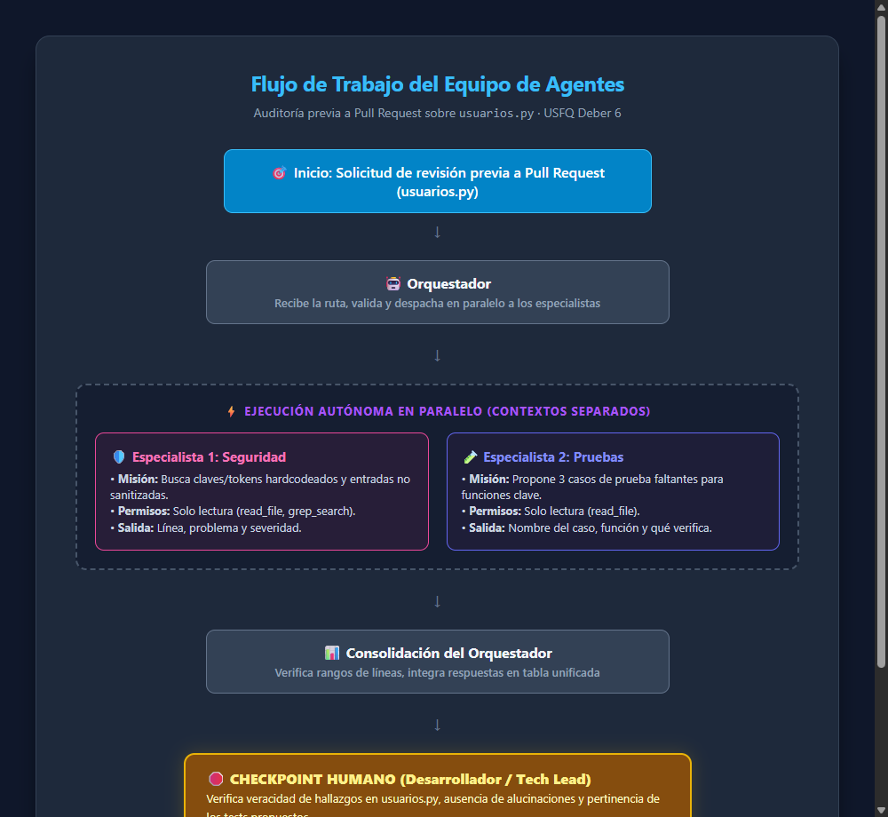
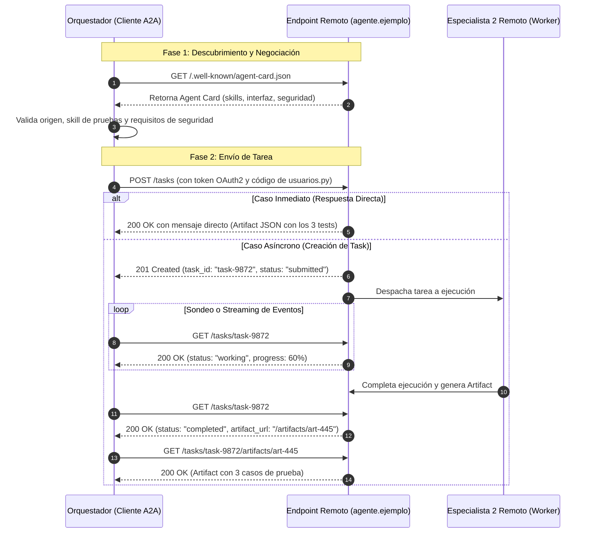
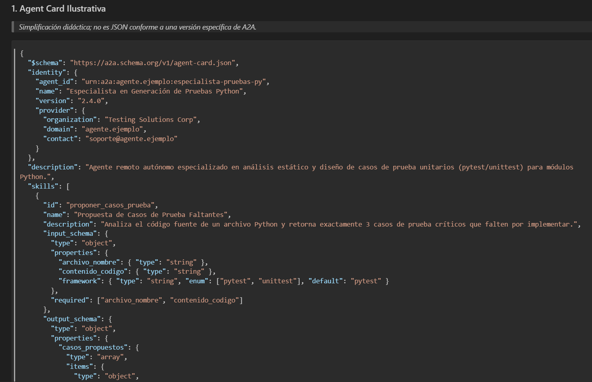

# Diseño del Equipo de Agentes: Revisión de `usuarios.py`

## Parte 1 — Diseño del Equipo

### 1. Tabla de Agentes

| Agente | Misión | Herramientas autorizadas | Entrada | Salida | Límites |
|---|---|---|---|---|---|
| **Orquestador** | Coordinar la revisión previa al Pull Request, repartir la tarea a los especialistas y consolidar sus resultados en un reporte estructurado. | Ninguna propia sobre el código (únicamente herramientas de delegación/orquestación). | Ruta del archivo (`usuarios.py` o ruta relativa/absoluta dentro del repositorio). | Tabla consolidada con hallazgos de seguridad y propuestas de casos de prueba. | No modifica archivos; no ejecuta código; no toma decisiones de aprobación sin intervención humana. |
| **Especialista 1 — Seguridad** | Analizar el archivo en busca de secretos/tokens en texto plano y entradas de usuario no sanitizadas o vulnerables (p. ej. inyección SQL). | Lectura y búsqueda (`read_file`, `grep_search`). | Ruta del archivo: `usuarios.py`. | Lista estructurada: `línea`, `problema`, `severidad` (Crítica, Alta, Media, Baja). | Estricto acceso de solo lectura; exclusivamente analiza `usuarios.py`; no escribe ni modifica archivos. |
| **Especialista 2 — Pruebas** | Proponer exactamente 3 casos de prueba faltantes para las funciones críticas de `usuarios.py`. | Lectura (`read_file`). | Ruta del archivo: `usuarios.py`. | Lista con 3 propuestas: `nombre_de_la_prueba`, `función objetivo`, `comportamiento/caso borde que verifica`. | Solo propone diseño de pruebas; no escribe archivos de tests ni ejecuta suites de pruebas. |

---

### 2. Diagrama del Flujo

Dado que el **Especialista 1 (Seguridad)** y el **Especialista 2 (Pruebas)** operan de forma independiente y analizan el mismo archivo base (`usuarios.py`), su ejecución se realiza en **paralelo**. El orquestador espera ambos resultados antes de construir la vista consolidada y solicitar la intervención humana en el **Checkpoint Humano**.





---

### 3. Criterios de Evaluación en el Checkpoint Humano

Antes de tomar una decisión en el checkpoint, la persona revisora analiza detalladamente la tabla consolidada.

#### ¿Qué mira la persona antes de aprobar?
1. **Veracidad y precisión de los hallazgos de seguridad:** Verifica en el código fuente de `usuarios.py` que las líneas señaladas realmente contengan el problema indicado (p. ej. confirmar si la línea 10 efectivamente contiene `API_KEY` y si la línea 21 realmente realiza concatenación en una consulta SQL).
2. **Severidad y aplicabilidad:** Comprueba que la severidad asignada corresponda al riesgo real y que no se trate de una advertencia irrelevante o código comentado.
3. **Calidad y pertinencia de los casos de prueba:** Confirma que los 3 casos de prueba propuestos cubran funciones reales del archivo (p. ej. `calcular_descuento`, `buscar_usuario`, `crear_usuario`) y evalúen casos límite o condiciones de fallo pertinentes (valores negativos, strings maliciosos, inyección SQL).
4. **Ausencia de modificaciones indebidas:** Valida mediante `git status` que `usuarios.py` no haya sido alterado por ninguno de los agentes.

#### ¿Qué la haría rechazar?
1. **Alucinaciones:** Hallazgos en líneas inexistentes o atribuidos a funciones que no están en `usuarios.py`.
2. **Falsos positivos flagrantes:** Reportar vulnerabilidades que el código ya mitiga o sugerir problemas que no aplican a la arquitectura.
3. **Casos de prueba sin sentido o redundantes:** Proponer pruebas triviales que no aportan valor, pruebas que asumen librerías no utilizadas, o proponer un número diferente al solicitado (3 casos).
4. **Violación de límites:** Que algún agente haya intentado crear o modificar archivos en el repositorio.

---

### 4. Detección y Manejo de Fallos de Especialistas

#### Cómo detecta el Orquestador que un especialista falló:
1. **Respuesta vacía o incompleta:** El especialista devuelve un cuerpo vacío, un mensaje de error no estructurado, o en el caso de pruebas, menos o más de 3 casos.
2. **Alucinación de referencias:** El orquestador puede contrastar que los números de línea reportados estén dentro del rango válido de `usuarios.py` (1 a 42 líneas). Si se referencia una línea mayor a 42, el hallazgo es inválido.
3. **Incumplimiento de formato:** La salida no sigue la estructura requerida (p. ej. no incluye severidad o no separa los campos solicitados).
4. **Violación de permisos/límites:** Detección de intentos de invocar herramientas de escritura (`write_file`, `edit_file`) o acceso a archivos fuera de `usuarios.py`.

#### Qué hace el Orquestador ante un fallo:
1. **Reintento con retroalimentación (1 reintento automático):** El orquestador envía un mensaje al especialista indicando el error exacto (ej. *"Formato inválido: la respuesta debe contener línea, problema y severidad. El archivo solo tiene 42 líneas."*).
2. **Aislamiento del fallo:** Si tras el reintento el especialista sigue fallando, el orquestador no aborta todo el flujo; incluye los resultados válidos del otro especialista y marca al especialista fallido con estado `[ERROR: Respuesta no válida o fallida]`.
3. **Notificación y escalamiento al Checkpoint Humano:** En el reporte final presentado a la persona, se alerta claramente de la falla para que el revisor humano decida si inspeccionar manualmente esa sección o relanzar la tarea.


---

## Parte 3 — A2A: Descubrimiento y Delegación a un Agente Remoto (Especialista 2)

En este escenario de diseño, el **Especialista 2 (Pruebas)** no corre como un proceso local en la máquina de desarrollo, sino como un servicio autónomo operado por otro equipo o proveedor en un servidor remoto. A continuación se detalla la arquitectura de descubrimiento y delegación mediante el protocolo **A2A (Agent-to-Agent)**.

---

### 1. Agent Card Ilustrativa

> *Simplificación didáctica; no es JSON conforme a una versión específica de A2A.*

```json
{
  "$schema": "https://a2a.schema.org/v1/agent-card.json",
  "identity": {
    "agent_id": "urn:a2a:agente.ejemplo:especialista-pruebas-py",
    "name": "Especialista en Generación de Pruebas Python",
    "version": "2.4.0",
    "provider": {
      "organization": "Testing Solutions Corp",
      "domain": "agente.ejemplo",
      "contact": "soporte@agente.ejemplo"
    }
  },
  "description": "Agente remoto autónomo especializado en análisis estático y diseño de casos de prueba unitarios (pytest/unittest) para módulos Python.",
  "skills": [
    {
      "id": "proponer_casos_prueba",
      "name": "Propuesta de Casos de Prueba Faltantes",
      "description": "Analiza el código fuente de un archivo Python y retorna exactamente 3 casos de prueba críticos que falten por implementar.",
      "input_schema": {
        "type": "object",
        "properties": {
          "archivo_nombre": { "type": "string" },
          "contenido_codigo": { "type": "string" },
          "framework": { "type": "string", "enum": ["pytest", "unittest"], "default": "pytest" }
        },
        "required": ["archivo_nombre", "contenido_codigo"]
      },
      "output_schema": {
        "type": "object",
        "properties": {
          "casos_propuestos": {
            "type": "array",
            "items": {
              "type": "object",
              "properties": {
                "nombre_test": { "type": "string" },
                "funcion_objetivo": { "type": "string" },
                "caso_borde_verificado": { "type": "string" }
              },
              "required": ["nombre_test", "funcion_objetivo", "caso_borde_verificado"]
            }
          }
        }
      }
    }
  ],
  "interface": {
    "protocol": "HTTPS",
    "base_url": "https://agente.ejemplo/api/a2a/v1",
    "endpoints": {
      "messages": "/messages",
      "tasks": "/tasks"
    }
  },
  "capabilities": {
    "streaming": true,
    "async_tasks": true,
    "max_execution_time_seconds": 60
  },
  "security": {
    "auth_type": "OAuth2",
    "authorization_url": "https://agente.ejemplo/oauth/token",
    "required_scopes": ["agent:test_generation:read", "agent:test_generation:write"],
    "rate_limits": {
      "requests_per_minute": 30
    }
  }
}
```

> **Aclaración de seguridad:** La *Agent Card* únicamente **anuncia** la identidad, las skills disponibles, el endpoint receptor y los requisitos criptográficos/seguridad exigidos por el agente remoto. **No ejecuta ninguna tarea por sí misma ni constituye una prueba de que el agente sea confiable**.

---

### 2. Obtención de la Tarjeta y Validaciones del Cliente

#### ¿Dónde se obtiene la Agent Card?
El orquestador cliente obtiene la tarjeta mediante el estándar de descubrimiento web canónico:
```text
GET https://agente.ejemplo/.well-known/agent-card.json
```
Alternativamente, en entornos corporativos o federados, puede obtenerse a través de un catálogo/registro de agentes de confianza interno (*Agent Registry*).

#### ¿Qué validaciones realiza el cliente antes de interactuar?
1. **Validación de Origen y Certificado:** Comprobar que el dominio responde sobre HTTPS con certificado TLS válido y que el nombre de dominio coincide con la identidad declarada (`agente.ejemplo`).
2. **Validación de Skill Requerida:** Verificar que la lista `skills` contenga la habilidad exacta requerida (`proponer_casos_prueba`) y que los esquemas de entrada y salida coincidan con lo que el orquestador puede proporcionar (`archivo_nombre`, `contenido_codigo`).
3. **Validación de Interfaz y Capacidades:** Confirmar compatibilidad con los endpoints declarados y soporte para procesamiento síncrono o creación de `Tasks` asíncronas.
4. **Validación de Requisitos de Seguridad:** Determinar si el orquestador cliente posee credenciales válidas (p. ej. token OAuth2 con los `required_scopes` solicitados) y si las políticas locales de la empresa autorizan el envío de código a dicho proveedor externo.

---

### 3. Secuencia de Comunicación A2A

La delegación sigue el flujo estándar de A2A:



> **Aclaración de diseño:** Una solicitud A2A **no siempre crea una Task**. Si la carga de cómputo es ligera y el procesamiento toma pocos milisegundos, el agente remoto puede responder de forma inmediata mediante un mensaje con el resultado estructurado. Si la tarea es intensiva o requiere cola de espera, se genera una `Task` con identificador único para seguimiento desacoplado.

---

### 4. Ciclo de Vida y Estados de la Task

```text
submitted  ───>  working  ───>  completed
    │               │
    ├───> input-required
    │
    └───> failed
```

1. **Camino estándar:**
   - `submitted`: La solicitud de análisis fue recibida, autenticada y encolada en el servidor remoto.
   - `working`: El agente remoto ha asignado recursos y se encuentra analizando `usuarios.py` para estructurar los casos de prueba.
   - `completed`: El análisis finalizó con éxito y el resultado estructurado (*Artifact*) está listo para consumo.

2. **Casos alternativos y manejo en el cliente:**
   - **Estado `input-required`:** Ocurre cuando el agente remoto necesita información adicional para proceder (por ejemplo, el agente remoto detecta que `usuarios.py` no especifica si debe usar `unittest` o `pytest`, o requiere conocer la versión de Python del proyecto).
     * **Acción del cliente:** El orquestador inspecciona el campo `required_input` en el estado de la tarea. Si dispone de la información en el contexto local (p. ej. `framework: "pytest"`), envía una respuesta mediante `POST /tasks/{id}/inputs` para reanudar el trabajo a estado `working`. Si la información no está disponible o requiere criterio humano, escala la consulta al desarrollador en el Checkpoint.
   - **Estado `failed`:** Ocurre si el servidor remoto experimenta un error de sintaxis al parsear el código, un timeout interno, o un error fatal de procesamiento.
     * **Acción del cliente:** El orquestador captura el código y detalle de error retornado, evita reintentos infinitos (aplica un máximo de 1 reintento con backoff exponencial) y, de persistir la falla, aísla el error, marca al Especialista 2 como no disponible y avisa al humano revisor en el Checkpoint para proceder con revisión manual de pruebas.

---

### 5. Qué cambia frente al Subagente Local y Diferencia con MCP

#### Diferencias frente al Subagente Local:
1. **Límite de Red y Latencia:** El subagente local se invoca en memoria mediante llamadas a funciones internas del harness (`invoke_subagent`), con latencia despreciable. El agente A2A opera a través de internet mediante HTTPS/JSON, sujeto a latencias de red, caídas de conexión y serialización.
2. **Descubrimiento Dinámico e Interoperabilidad:** El subagente local requiere archivos locales específicos vinculados rígidamente al motor utilizado (`.gemini/agents/`, `.claude/agents/`). En A2A, cualquier agente cliente puede consumir cualquier agente servidor sin importar su tecnología o lenguaje subyacente, gracias al estándar de la *Agent Card*.
3. **Frontera de Confianza (Zero-Trust):** El subagente local comparte la máquina y el entorno del desarrollador. En A2A, el orquestador y el especialista pertenecen a dominios administrativos distintos: el código enviado viaja fuera de la organización, exigiendo acuerdos de confidencialidad, autenticación estricta (OAuth2) y sanitización previa.

#### A2A vs. MCP (Model Context Protocol):
- **MCP conecta un agente con HERRAMIENTAS y RECURSOS:** Si el orquestador necesita leer directamente archivos del sistema, consultar una base de datos o listar repositorios en GitHub, utiliza una herramienta local o un servidor **MCP**. En MCP, el orquestador mantiene el 100% del control del razonamiento y decide paso a paso qué llamada a herramienta ejecutar.
- **A2A conecta un agente con OTRO AGENTE:** Si el orquestador necesita delegar una meta completa a una entidad autónoma remota (ej. *"diseña de forma independiente la suite de pruebas para este módulo y devuélveme el informe final"*), utiliza **A2A**. En A2A se delega la **autonomía de decisión y orquestación interna**, no solo la ejecución instrumental de un método.
- **Conclusión arquitectónica:** La elección entre MCP y A2A depende de la arquitectura y de la interfaz de comunicación (herramienta vs. delegación de autonomía), **no de si la tarea involucra o no leer archivos**.



