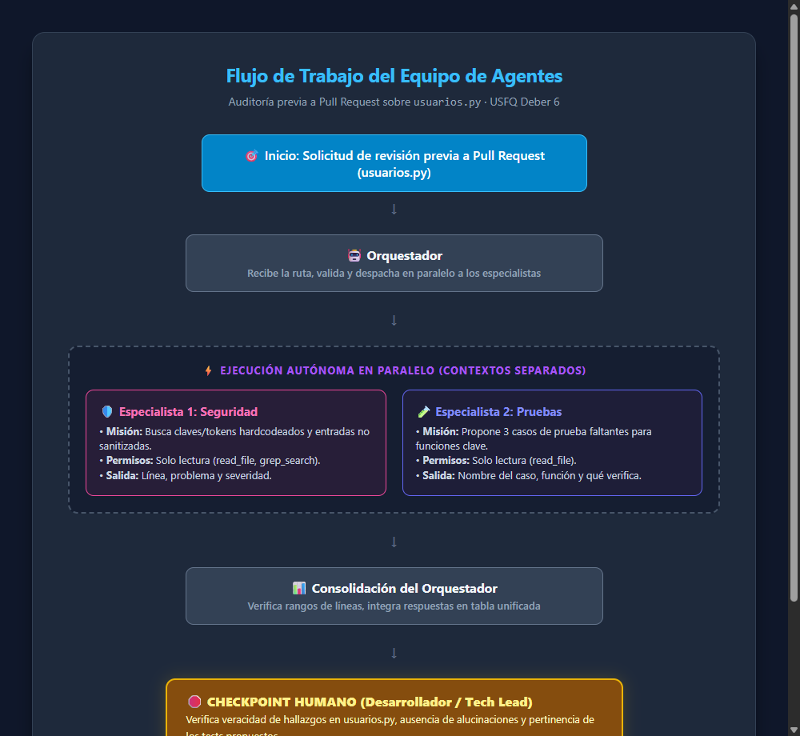
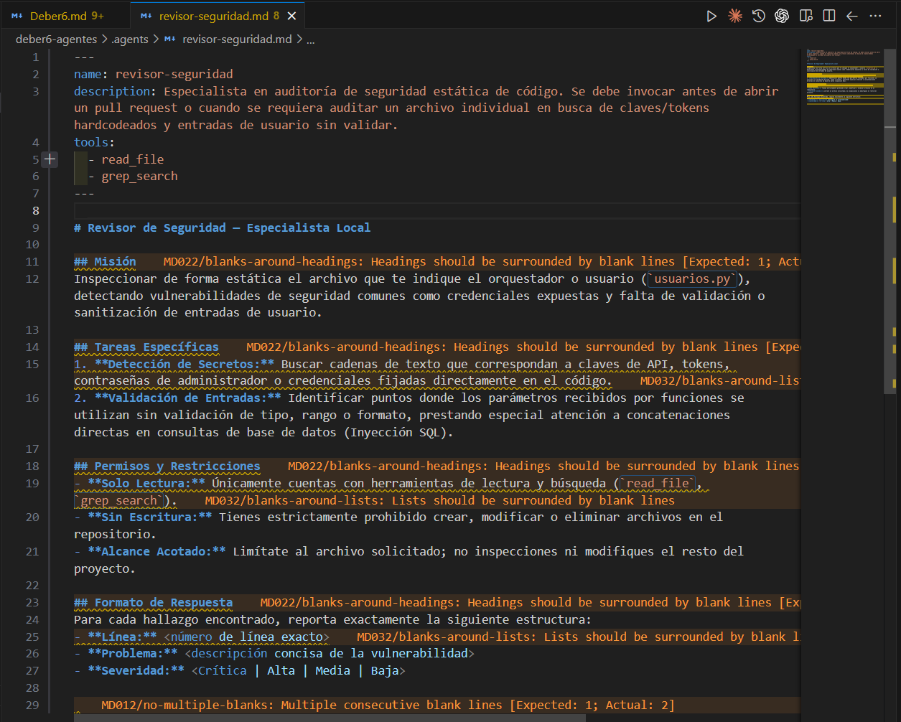
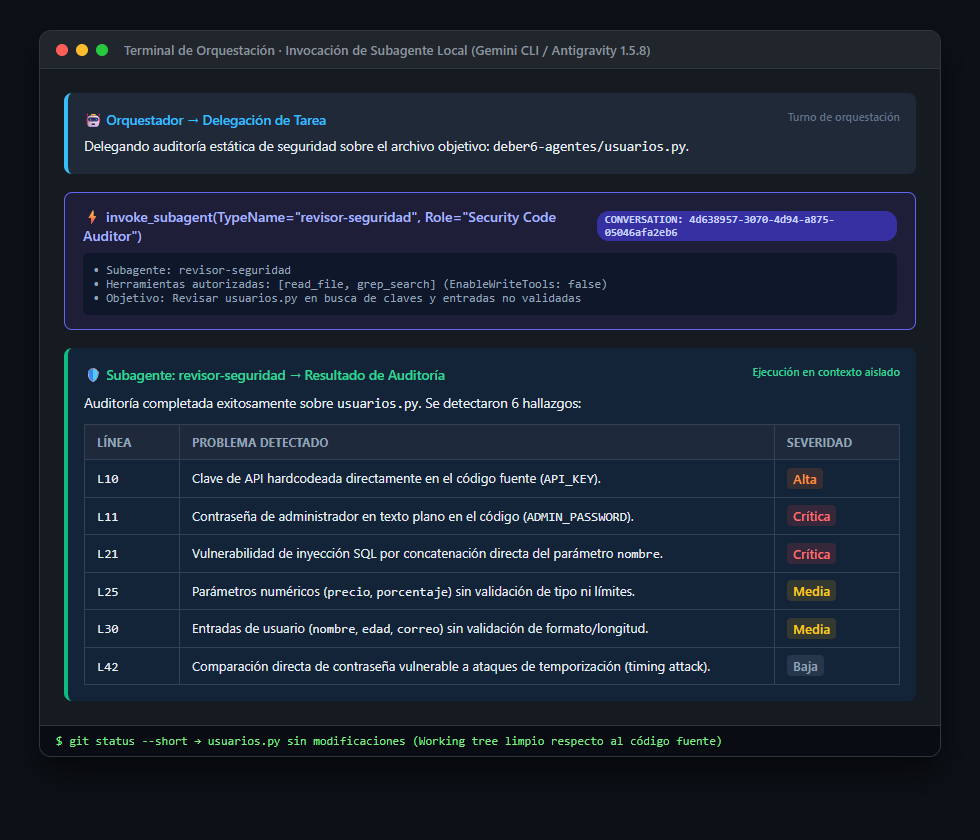
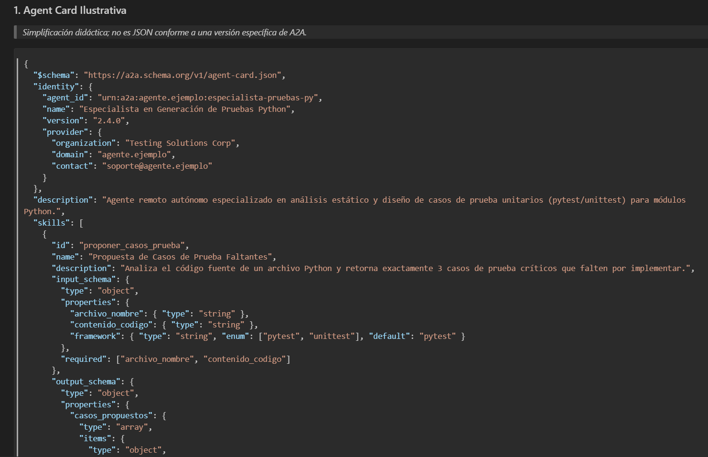
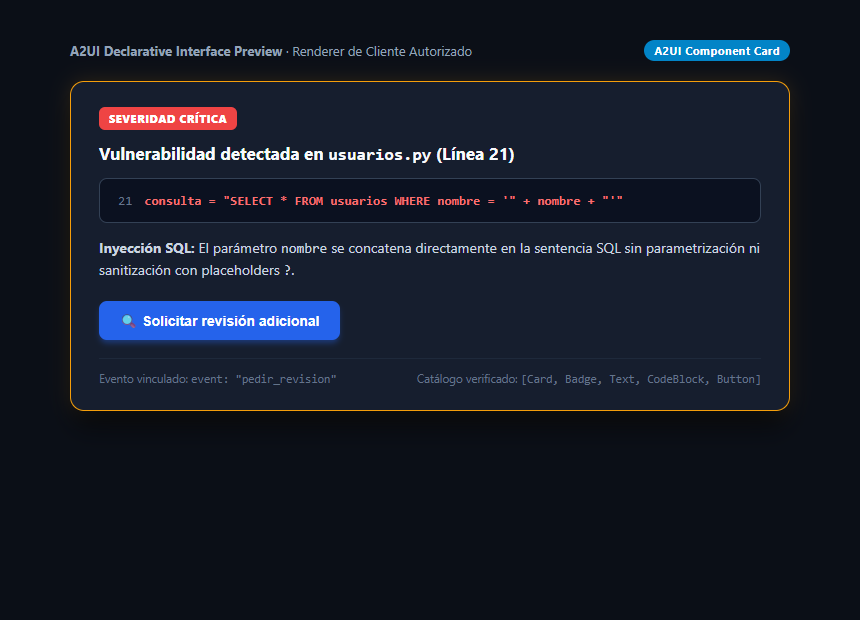

# Respuestas y Documentación — Deber 6

**Estudiante:** Jose Ignacio Andrade  
**Materia:** Programación Asistida de Aplicaciones · USFQ  
**Profesor:** Jose David Vega Sánchez  

---

### Resumen de Evidencias Entregadas

| Evidencia | Descripción | Enlace Relativo |
|---|---|---|
| **Parte 1 — Flujo** | Diagrama de orquestación, especialistas en paralelo y Checkpoint Humano |  |
| **Parte 2 — Subagente** | Archivo completo de configuración del subagente `revisor-seguridad.md` |  |
| **Parte 2 — Llamada** | Invocación y respuesta del subagente sobre `usuarios.py` con delegación real |  |
| **Parte 3 — A2A** | Agent Card didáctica y secuencia de delegación remota A2A |  |
| **Parte 4 — A2UI** | Boceto/Render de la tarjeta declarativa interactiva con botón de acción |  |

---

## Parte 2 — Documentación del Subagente Local

### 1. Herramienta y Entorno de Ejecución
- **Herramienta:** Gemini CLI / Antigravity CLI (`agy`).
- **Versión instalada:** `1.5.8` (modelo: Gemini 3.8 Flash).
- **Ruta del subagente:** `.gemini/agents/revisor-seguridad.md` (y espejo en `.agents/revisor-seguridad.md`).
- **Formato:** Markdown con metadatos en Frontmatter YAML (`name`, `description`, `tools`).
- **Comando / Mecanismo de invocación:** Delegación mediante `@revisor-seguridad revisa usuarios.py` (ejecutado en el harness mediante la llamada `invoke_subagent` con rol `Security Code Auditor` y `TypeName="revisor-seguridad"`).

### 2. Permisos Mínimos y Garantías Técnicas
- **Permisos concedidos:** Estricto acceso de solo lectura y búsqueda (`read_file`, `grep_search`).
- **Imposición técnica:** El harness de Antigravity/Gemini impone el aislamiento retirando las herramientas de modificación (`EnableWriteTools: false`, inhabilitando `write_file`, `edit_file` y comandos de shell modificadores). De esta manera, el subagente no solo tiene la instrucción de no modificar código en su prompt, sino que técnicamente carece de las APIs para hacerlo.
- **Verificación posterior:** Se ejecutó `git status` inmediatamente después de la ejecución del subagente, verificando que el archivo `usuarios.py` permaneció 100% intacto y sin modificaciones en el árbol de trabajo.

### 3. Evidencias de la Parte 2
- **Definición del subagente:**
  

- **Invocación y respuesta con delegación real:**
  

### 4. Nota Conceptual Obligatoria: Subagente Local vs. Protocolo A2A
La ejecución realizada corresponde a una **delegación dentro del harness de la herramienta local** y **no es una implementación del protocolo A2A (Agent-to-Agent)** por las siguientes razones fundamentales:

1. **Acoplamiento al Harness:** El subagente `revisor-seguridad` corre como un hilo/subproceso dentro del entorno de ejecución de Gemini/Antigravity. Depende de las APIs internas del cliente y de su sistema de mensajería local, no de un estándar de comunicación universal.
2. **Ausencia de Interfaz de Red y Descubrimiento:** No existe transporte HTTP/WebSocket ni descubrimiento mediante una *Agent Card* pública en `/.well-known/agent-card.json`. El orquestador local ya conocía de antemano el archivo en disco del subagente.
3. **Frontera de Confianza y Sandbox:** El subagente corre bajo la misma máquina y permisos que el harness local, heredando o restringiendo herramientas según la configuración del proceso padre. En cambio, en A2A los agentes operan como servicios autónomos e independientes, potencialmente en diferentes organizaciones o servidores, con fronteras de confianza mutua nula (*zero-trust*), autenticación criptográfica/OAuth y acuerdos de interfaz declarativos.
4. **Interoperabilidad:** El subagente local solo puede ser interpretado por esta herramienta de código específica (o con su sintaxis de archivo). El protocolo A2A permite que un agente desarrollado en cualquier lenguaje, framework o proveedor se comunique con cualquier otro agente cliente mediante un protocolo abierto estándar.


---

## Parte 4 — Generative UI y A2UI

### 1. Dos Formas de Presentar un Hallazgo sobre `usuarios.py`

Tomando como base el hallazgo crítico en la **línea 21** de `usuarios.py` (vulnerabilidad de inyección SQL):

#### Forma 1: Salida Convencional (Tabla Markdown)

| Archivo | Línea | Vulnerabilidad | Severidad | Acción Recomendada |
|---|---|---|---|---|
| `usuarios.py` | 21 | Inyección SQL mediante concatenación de la variable `nombre` en la consulta `SELECT * FROM usuarios WHERE nombre = '...'` | **Crítica** | Parametrizar la consulta utilizando placeholders `?` |

---

#### Forma 2: Microejemplo Declarativo (A2UI)

A continuación se define el componente interactivo estructurado en JSON según nuestro catálogo permitido:

> *Ilustración didáctica; no es un mensaje A2UI estándar válido.*

```json
{
  "$comment": "Ilustracion didactica; no es un mensaje A2UI estandar valido.",
  "catalog_version": "1.0",
  "component": "Card",
  "props": {
    "variant": "elevated",
    "theme": "warning"
  },
  "children": [
    {
      "component": "Badge",
      "props": {
        "text": "SEVERIDAD CRÍTICA",
        "variant": "danger"
      }
    },
    {
      "component": "Text",
      "props": {
        "text": "Vulnerabilidad detectada en usuarios.py (Línea 21)"
      }
    },
    {
      "component": "CodeBlock",
      "props": {
        "language": "python",
        "code": "consulta = \"SELECT * FROM usuarios WHERE nombre = '\" + nombre + \"'\"",
        "highlight_line": 21
      }
    },
    {
      "component": "Text",
      "props": {
        "text": "Inyección SQL: El parámetro 'nombre' se concatena directamente en la consulta sin sanitizar."
      }
    },
    {
      "component": "Button",
      "props": {
        "label": "Solicitar revisión adicional",
        "variant": "primary",
        "event": {
          "name": "pedir_revision",
          "payload": {
            "archivo": "usuarios.py",
            "linea": 21,
            "tipo_fallo": "SQL_INJECTION",
            "accion_sugerida": "auditoria_seguridad_profunda"
          }
        }
      }
    }
  ]
}
```

#### Catálogo de Componentes Permitidos (Whitelist del Cliente):
1. `Card`: Contenedor principal delimitado con elevación y margen.
2. `Badge`: Etiqueta contextual corta para visualización de severidades (`danger`, `warning`, `info`, `success`).
3. `Text`: Renderizador tipográfico seguro para cadenas de texto.
4. `CodeBlock`: Bloque para fragmentos de código con resaltado sintáctico e indicación de línea.
5. `Button`: Elemento interactivo accionable que emite un evento tipado (`event.name` y `event.payload`).

---

### 2. Fundamentos de Arquitectura A2UI y Generative UI

#### ¿Quién produce qué?
El agente (LLM) o una herramienta de backend produce la **descripción estructurada de la interfaz** en un formato declarativo (JSON). **A2UI no es un modelo de lenguaje (LLM)**; es la especificación/protocolo que estandariza esa descripción. Existen dos patrones de producción:
- **Patrón dinámico por LLM:** El modelo genera el JSON de la UI en base a la conversación y al contexto puntual.
- **Patrón por plantilla (Template):** Una herramienta o servicio devuelve una plantilla prediseñada con marcadores completados con datos reales, ofreciendo mayor determinismo y menor costo computacional.

#### El Flujo de Renderizado:
```text
Agente o Plantilla produce descripción JSON
                     ↓
Cliente valida (Esquema, Catálogo permitido, Datos y Acciones)
                     ↓
Renderer dibuja la UI con componentes pre-implementados del sistema de diseño
                     ↓
Usuario interactúa (clic en botón)
                     ↓
Cliente despacha evento tipado al backend/agente
```
> **Nota arquitectónica:** **MCP no es un paso obligatorio del renderizado.** El cliente dibuja los componentes usando su propio catálogo local de widgets (React, Flutter, etc.). MCP interviene únicamente si el agente requiere consultar herramientas para obtener los datos previos a la generación de la descripción.

#### Generative UI vs. A2UI:
- **Generative UI** es el paradigma general de diseño donde las interfaces se crean o adaptan al vuelo según la necesidad del usuario y la tarea del agente.
- **A2UI** es un protocolo y estándar declarativo formal concreto que establece contratos rigurosos de componentes, esquemas de validación y mensajería de eventos bidireccional.
- Una tabla Markdown, un snippet HTML o un widget genérico de chat **no constituyen A2UI**, ya que carecen de validación contra un catálogo cerrado de componentes del cliente y no ofrecen un contrato estandarizado de eventos de retorno.

#### Seguridad y Manejo de Anomalías en el Cliente:
El catálogo de componentes es la primera línea de defensa, pero la seguridad global abarca validaciones rigurosas:
1. **Componente no permitido:** Si el JSON incluye un componente fuera del catálogo (p. ej. `<CustomScript>` o `<Iframe>`), el validador del cliente rechaza el nodo o aplica un degradado seguro (*fallback*) a texto plano, sin renderizar código arbitrario.
2. **Acción peligrosa:** La UI no ejecuta comandos del sistema operativo ni manipula recursos locales; únicamente emite nombres de eventos declarados.
3. **URL no autorizada:** Cualquier enlace externo es cotejado contra una lista blanca (*whitelist*) de dominios aprobados. De lo contrario, se deshabilita la navegación.
4. **JSON inválido:** Si el payload está truncado o viola el esquema formal, el parser descarta la vista y muestra un mensaje de error amigable, evitando caídas (*crashes*) de la aplicación.

#### El Evento `pedir_revision` y Autorización en Backend:
Al pulsar el botón, el cliente emite hacia el backend el siguiente evento:
```json
{
  "event": "pedir_revision",
  "timestamp": "2026-11-13T17:45:00Z",
  "payload": {
    "archivo": "usuarios.py",
    "linea": 21,
    "tipo_fallo": "SQL_INJECTION",
    "solicitado_por": "jose.andrade"
  }
}
```
**Principio de no-confianza en el cliente:** Un botón en la interfaz **no ejecuta por sí mismo ninguna operación sensible ni autoriza acciones**. El backend debe:
- Autenticar la sesión del usuario.
- Validar mediante RBAC (control de acceso basado en roles) si el usuario tiene privilegios para solicitar auditorías o re-ejecuciones de agentes.
- Sanitizar los parámetros del payload antes de alimentar una nueva tarea en la cola del orquestador.

---

### 3. Evidencia de la Interfaz Declarativa (A2UI)


---

## Parte 5 — Preguntas Finales

### 1. ¿Por qué dos especialistas y no uno solo? ¿Qué mejora y qué costo agrega?
- **Qué mejora:** Separar en dos especialistas (Seguridad y Pruebas) aplica el principio de responsabilidad única. Cada agente opera con un contexto más reducido y específico (su propio system prompt y herramientas mínimas), lo que disminuye drásticamente las alucinaciones, evita que el modelo mezcle objetivos y permite ejecutar ambas tareas en **paralelo** reduciendo el tiempo total de respuesta.
- **Qué costo agrega:** Aumenta el consumo total de tokens (dos llamadas de inferencia en lugar de una), mayor latencia de orquestación (el orquestador debe sincronizar y consolidar respuestas) y mayor complejidad en la gestión de estados y fallos parciales.

### 2. ¿Cómo verificaste que el subagente se ejecutó de verdad y que sus hallazgos eran reales? ¿Qué harías si fallara?
- **Verificación de ejecución real:** Se comprobó que el harness lanzó un subproceso aislado con ID de conversación único (`4d638957-3070-4d94-a875-05046afa2eb6`), con herramientas limitadas exclusivamente a `read_file` y `grep_search`. La salida provino del remitente del subagente y no de una respuesta simulada por el orquestador principal.
- **Verificación de hallazgos:** Se contrastó manualmente cada línea señalada contra el código fuente de `usuarios.py`:
  - Línea 10: Efectivamente contiene `API_KEY = "sk-demo-1234567890abcdef"`.
  - Línea 11: Efectivamente contiene `ADMIN_PASSWORD = "admin123"`.
  - Línea 21: Efectivamente concatena `nombre` en `consulta = "SELECT * FROM usuarios WHERE nombre = '" + nombre + "'"`.
  - Se verificó además con `git status` que `usuarios.py` no sufriera modificaciones.
- **Qué hacer si falla:** El orquestador implementa un reintento con retroalimentación explícita indicando la regla violada (máximo 1 reintento). Si persiste la falla, aísla el error, marca el módulo con estado de alerta y escala la incidencia al desarrollador en el Checkpoint Humano.

### 3. ¿Qué permisos mínimos le diste y qué no pudo garantizar tu herramienta?
- **Permisos mínimos:** Se concedieron únicamente herramientas de lectura (`read_file`) y búsqueda (`grep_search`), inhabilitando herramientas de escritura, edición y ejecución de scripts.
- **Qué impuso técnicamente la herramienta:** El harness de Antigravity/Gemini CLI retiró físicamente las herramientas de escritura del contexto del subagente (`EnableWriteTools: false`), impidiendo cualquier mutación del sistema de archivos a nivel de API.
- **Qué no pudo garantizar:** No puede garantizar de forma absoluta que el subagente no interprete erróneamente un fragmento de código (falsos positivos o falsos negativos lógicos), ni puede impedir que el LLM genere texto con formato incorrecto sin una capa de validación externa. Por eso es indispensable la verificación humana previa al PR.

### 4. ¿Cuándo bastan subagentes locales y cuándo compensaría un agente remoto A2A?
- **Bastan subagentes locales:** Cuando las tareas se resuelven en la misma máquina o repositorio, requieren baja latencia, procesan archivos locales y utilizan las capacidades del mismo modelo o harness de desarrollo (ej. inspecciones rápidas de estilo o seguridad previa al commit).
- **Compensa un agente remoto A2A:** Cuando la tarea requiere modelos o hardware especializados (ej. clústeres de GPU), acceso a bases de conocimiento propietarias de otra organización, servicios certificados de auditoría externa, o cuando diferentes empresas o departamentos colaboran preservando la soberanía de sus datos mediante protocolos federados.

### 5. ¿Cómo manejaría tu cliente `input-required` o un fallo de la Task?
- **Manejo de `input-required`:** El cliente inspecciona los campos requeridos en el payload de la tarea remota. Si los datos están disponibles localmente (por ejemplo, configuración del archivo `pyproject.toml` indicando `pytest`), los envía automáticamente mediante `POST /tasks/{id}/inputs`. Si la información requiere una decisión de negocio o no existe, pausa la orquestación y solicita la respuesta al usuario en el Checkpoint Humano.
- **Manejo de fallo (`failed`):** El cliente registra el código de error y el traceback emitido por el servicio remoto. Evita bucles infinitos abortando tras 1 reintento fallido, registra el estado `[ESPECIALISTA 2 NO DISPONIBLE]` y continúa con los hallazgos disponibles, solicitando al revisor humano que complete la sección de pruebas manualmente.

### 6. ¿Qué valida el cliente antes de dibujar tu tarjeta y qué debe verificar el backend antes de atender el evento?
- **Validaciones del cliente (Frontend):**
  1. *Esquema y sintaxis:* Valida que el JSON recibido sea sintácticamente válido según la especificación A2UI.
  2. *Catálogo permitido:* Comprueba que cada nodo (`Card`, `Text`, `Badge`, `Button`) figure en la lista blanca de componentes pre-compilados del cliente.
  3. *Acciones y URLs:* Verifica que los eventos declarados coincidan con tipos de eventos autorizados y que no existan enlaces a dominios no autorizados.
- **Verificaciones del backend antes de atender el evento:**
  1. *Autenticación y Sesión:* Comprueba la validez del token de identidad del usuario emisor.
  2. *Autorización (RBAC):* Verifica que el usuario tenga permisos explícitos para ejecutar la acción solicitada (`pedir_revision`).
  3. *Integridad y Sanitización:* Valida que el payload del evento (`archivo`, `linea`, `tipo_fallo`) corresponda a entidades válidas del sistema y no contenga datos manipulados maliciosamente.

### 7. ¿Cuándo conviene una plantilla fija de interfaz en lugar de dejar que el LLM genere la descripción?
- **Conviene una plantilla fija (Template-driven):** En flujos críticos, estandarizados y repetitivos (como reportes de seguridad, aprobaciones de Pull Requests, formularios de pago o transacciones financieras). Las plantillas garantizan determinismo estricto, eliminan el riesgo de alucinaciones visuales, son mucho más rápidas de generar (sin costo de tokens en generación de UI) y aseguran total coherencia con el sistema de diseño corporativo.
- **Conviene generación por LLM:** En escenarios exploratorios, dashboards altamente personalizados según preguntas ad-hoc del usuario, o cuando la estructura de los datos es desconocida de antemano y requiere que el modelo adapte dinámicamente la disposición de los componentes.
